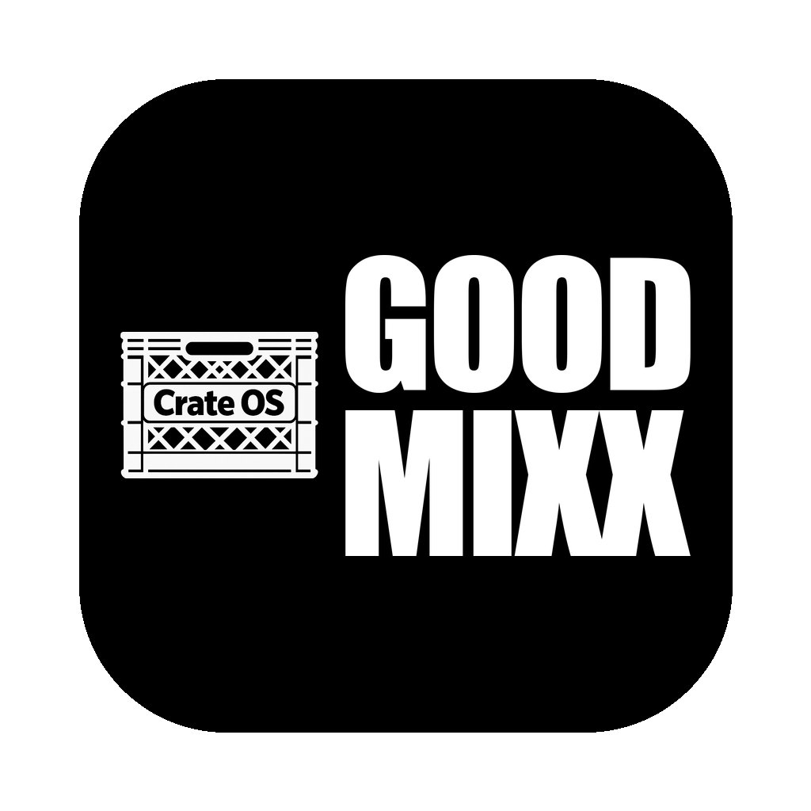

<div align="center">



# GOOD MIXX

### Remember the blends that work. Know what to play next.

A booth companion from **Crate OS by XTRA GOOD LABS** for **djay** and **Traktor Pro 4 or 3** on the Mac,
with your iPad as the second screen. Original idea by **DJ Aquarobotics**.

[](https://github.com/XTRAGOODLABS/good-mixx/actions/workflows/ci.yml)
[](https://github.com/XTRAGOODLABS/good-mixx/releases/latest)


[**Download for Mac**](https://github.com/XTRAGOODLABS/good-mixx/releases/latest) · [**Install guide**](INSTALL-MAC.md) · [**Version history**](CHANGELOG.md) · [**What's next**](ROADMAP.md)

</div>


## How it works

| Follows your decks | Remembers good mixes | Suggests what's next |
|---|---|---|
| Reads what djay or Traktor is playing on the Mac — no typing | Tap **GOOD MIX** when two songs blend well | Your proven mixes first, then BPM + key matches |
| Switch between djay and Traktor in the same set | After the gig, review the set and keep the good ones | Same-show and energy-up filters |
| Keys shown the way your DJ app shows them | Saved on your Mac, never in the cloud | Works on the Mac or any iPad on the same Wi-Fi |

## STUDIO: turn good mixes into a finished mix

In the GOOD MIXX window on the Mac, the **STUDIO** tab builds a mix in the spirit of DJ.Studio:

- **Recreate a set** you played in djay or Traktor on this Mac, in the order you played it.
- **Build a new mix** from your saved good mixes (chain them: "next after this song") or your song list.
- **Three blend styles**, for the whole mix or song by song: **beat-matched** (tempo matched with the pitch kept,
  beats lined up, blended over 8/16/32 bars), **your set's timing** (each song comes in when it did in the real set),
  or a **simple crossfade**.
- **BUILD MP3 / WAV** saves the finished mix plus a timed tracklist to `Music/GOOD MIXX`.
  **SAVE PLAYLIST** saves an `.m3u8` playlist and tracklist to load and play live.

Only songs saved as files on the Mac can go in the audio mix (streamed songs are listed but left out).
GOOD MIXX finds files through djay, Traktor, your song list and Spotlight, or you can point to one with **FIND**.
Building audio needs the free [ffmpeg](https://ffmpeg.org) (`brew install ffmpeg`); playlists work without it.
djay keeps which songs you played and when, not your fader or EQ moves, so recreated blends are rebuilt.


## What it reads, and what it never does

- **djay:** its own library file on the Mac (read-only) and, for keys djay no longer saves, the title, artist
  and key text on each deck through macOS Accessibility. It never clicks or changes anything in djay.
- **Traktor Pro 4 / 3:** a small add-on (the free traktor-api-client) that sends each deck's song, key, BPM and play
  state to GOOD MIXX on the same Mac, plus Traktor's collection file (read-only).
- Nothing leaves your Mac. No accounts, no internet needed.

## Run from source

```bash
python3 app/mixes_server.py        # then open http://localhost:8770/mixes
python3 tests/smoke_test.py        # quick end-to-end check
python3 tests/studio_test.py       # STUDIO: beat matching, set timing, building an MP3 (needs ffmpeg)
bash scripts/package-mac.sh        # builds dist/GOOD MIXX/ and the release zip
```

Needs Python 3 (macOS developer tools include it). `GOODMIXX_DATA` sets where mixes and history are kept.

## Credits

**Idea: DJ Aquarobotics** — the original concept of a booth tool that remembers good mixes and suggests
what to play next. Built by XTRA GOOD LABS with Claude.
Thanks to [djay-pro-mcp](https://github.com/ckryptickunal/djay-pro-mcp) by **ckryptickunal** for inspiration. Traktor link based on
[traktor-api-client](https://github.com/ErikMinekus/traktor-api-client) by Erik Minekus (MIT).
Fonts: IBM Plex (OFL). See [THIRD-PARTY-NOTICES.md](THIRD-PARTY-NOTICES.md).
Project code is not yet under an open-source license; all rights reserved until one is chosen.
