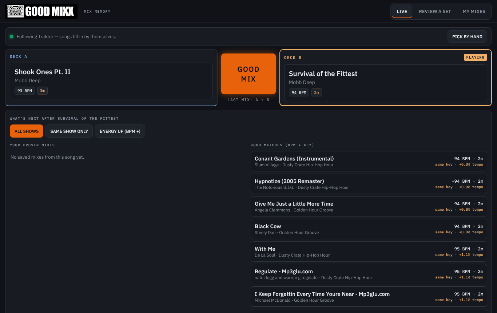
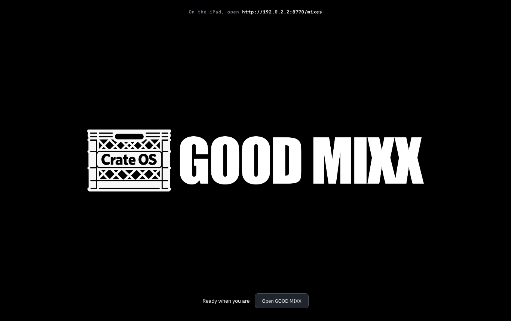

<div align="center">


# GOOD MIXX™

### Remember the blends that work. Know what to play next.

A booth companion from **Crate OS by XTRA GOOD LABS** for **djay** and **Traktor Pro 4 or 3** on the Mac,
with your iPad as the second screen. Original idea by **DJ Aquarobotics**.

**[Website & download → xtragoodlabs.github.io/good-mixx](https://xtragoodlabs.github.io/good-mixx/)** · [**Buy me a coffee ☕**](https://buymeacoffee.com/xtragoodlabs) · [**More from XTRA GOOD LABS**](https://github.com/XTRAGOODLABS)

[](https://github.com/XTRAGOODLABS/good-mixx/actions/workflows/ci.yml)
[](https://github.com/XTRAGOODLABS/good-mixx/releases/latest)


[**Download for Mac**](https://github.com/XTRAGOODLABS/good-mixx/releases/latest) · [**Install guide**](INSTALL-MAC.md) · [**Version history**](CHANGELOG.md) · [**What's next**](ROADMAP.md)

</div>



## How it works

| Follows your decks | Remembers good mixes | Suggests what's next |
|---|---|---|
| Reads what djay or Traktor is playing on the Mac — no typing | Tap **GOOD MIX** when two songs blend well | Your proven mixes first, then BPM + key matches |
| Switch between djay and Traktor in the same set | After the gig, review the set and keep the good ones | Same-show and energy-up filters |
| Keys shown the way your DJ app shows them | Saved on your Mac, never in the cloud | Works on the Mac or any iPad on the same Wi-Fi |

## Set recorder: rebuild a set exactly as you played it

djay's history only keeps which songs you played and when. The **set recorder** follows djay on the Mac while you
play - play/pause, where each deck is in its song, tempo, channel faders, crossfader, filter and EQ - and STUDIO's
**As recorded** blend rebuilds the set from that: each song starts from the spot you started it, at your tempo,
with your fader, crossfader, filter and EQ moves replayed (and its beats nudged onto the other song's beats).

Click **SET UP RECORDER** in the Mac window once (needs [Node.js](https://nodejs.org) 22.13+, e.g. `brew install node`),
then quit and reopen djay. After that it records whenever djay is open; **REC** turns it on or off.
It uses [djay-pro-mcp](https://github.com/ckryptickunal/djay-pro-mcp) by ckryptickunal (MIT) to read djay through
its MIDI controller feedback and on-screen readouts - it only reads, never changes anything in djay.
**SET UP RECORDER** downloads djay-pro-mcp from GitHub (a tested version) into a `djay-pro-mcp` folder in your
home folder and installs it - that's why the recorder needs Node.js. It isn't bundled with GOOD MIXX.
Works with djay Pro on the Mac (tested with 5.6.10); sets played on the iPad can't be recorded.

## STUDIO: turn good mixes into a finished mix

In the GOOD MIXX window on the Mac, the **STUDIO** tab builds a mix in the spirit of DJ.Studio:

- **Recreate a set** you played in djay or Traktor on this Mac, in the order you played it.
- **Build a new mix** from your saved good mixes (chain them: "next after this song") or your song list.
- **Three blend styles**, for the whole mix or song by song: **beat-matched** (tempo matched with the pitch kept,
  beats lined up, blended over 8/16/32 bars), **your set's timing** (each song comes in when it did in the real set),
  or a **simple crossfade**. Set timing uses your djay cue points: each song starts from cue 1, or from a later cue
  when cue 1 starts on an intro, comes in when djay says you started it, and is beat-matched to the song before.
  Where djay's times don't add up it blends automatically; songs you only played for seconds are flagged as skips.
- **Song waves on the timeline**, with zoom, so you can see each song, its blends and fades.
- **Move the audio around:** drag a song to bring it in earlier or later (beat-matched blends snap to whole bars,
  hold ⌥ for single beats), drag its left edge to skip into it.
  ◂ ▸ nudge by a bar, ↺ puts it back, UNDO / ⌘Z undoes.
- **⤢ BIG** timeline with tall lanes, bar / beat lines and a volume line, so waveforms are easy to line up.
  Every song has its own **◆ fade-in** and **◆ fade-out** handles, and its **right edge** sets how long it keeps
  playing under the next song - adjusting one song never changes the other.
- **Blend effects** per blend: low-pass out, high-pass out, high-pass in, bass swap - in previews and the final mix.
- **▶ BLEND** plays just that blend (built the same way as the full mix) with a moving playhead; **▶ PLAY** plays the finished mix.
- **BUILD MP3 / WAV** saves the finished mix plus a timed tracklist to `Music/GOOD MIXX`.
  **SAVE PLAYLIST** saves an `.m3u8` playlist and tracklist to load and play live.

Only songs saved as files on the Mac can go in the audio mix (streamed songs are listed but left out).
GOOD MIXX finds files through djay, Traktor, your song list and Spotlight, or you can point to one with **FIND**.
Building audio needs the free [ffmpeg](https://ffmpeg.org) (`brew install ffmpeg`); playlists work without it.
djay keeps which songs you played and when, not your fader or EQ moves, so recreated blends are rebuilt.



## What it reads, and what it never does

- **djay:** its own library file on the Mac (read-only) and, for keys djay no longer saves, the title, artist
  and key text on each deck through macOS Accessibility. It never clicks or changes anything in djay.
- **Traktor Pro 4 / 3:** a small add-on (the free traktor-api-client) that sends each deck's song, key, BPM and play
  state to GOOD MIXX on the same Mac, plus Traktor's collection file (read-only).
- Nothing leaves your Mac. No accounts, no internet needed.

## Run from source

```bash
python3 app/mixes_server.py        # then open http://localhost:8770/mixes
python3 tests/smoke_test.py        # quick end-to-end check
python3 tests/studio_test.py       # STUDIO: beat matching, set timing, building an MP3 (needs ffmpeg)
python3 tests/recorder_test.py     # set recorder: reading logs, As-recorded rebuild, replayed moves
bash scripts/package-mac.sh        # builds dist/GOOD MIXX/ and the release zip
```

Needs Python 3 (macOS developer tools include it). The Mac app window (`macos/GoodMixxApp.swift`) is built by GitHub
on a Mac for every change and published with each release; `scripts/package-mac.sh` without it falls back to a browser window. `GOODMIXX_DATA` sets where mixes and history are kept.

## Credits

**Idea: DJ Aquarobotics** — the original concept of a booth tool that remembers good mixes and suggests
what to play next. Built by XTRA GOOD LABS with Claude.
**Set recorder: built on [djay-pro-mcp](https://github.com/ckryptickunal/djay-pro-mcp) by ckryptickunal** (MIT) - it's how GOOD MIXX
reads djay live. Thank you! Traktor link based on
[traktor-api-client](https://github.com/ErikMinekus/traktor-api-client) by Erik Minekus (MIT).
Fonts: IBM Plex (OFL). See [THIRD-PARTY-NOTICES.md](THIRD-PARTY-NOTICES.md).
djay is a trademark of Algoriddim and Traktor of Native Instruments. GOOD MIXX is an independent tool, not affiliated with or endorsed by either.
Project code is not yet under an open-source license; all rights reserved until one is chosen.

---

GOOD MIXX™, Spin Deck™, Crate OS™ and Beatdeck™ are trademarks of XTRA GOOD LABS.
